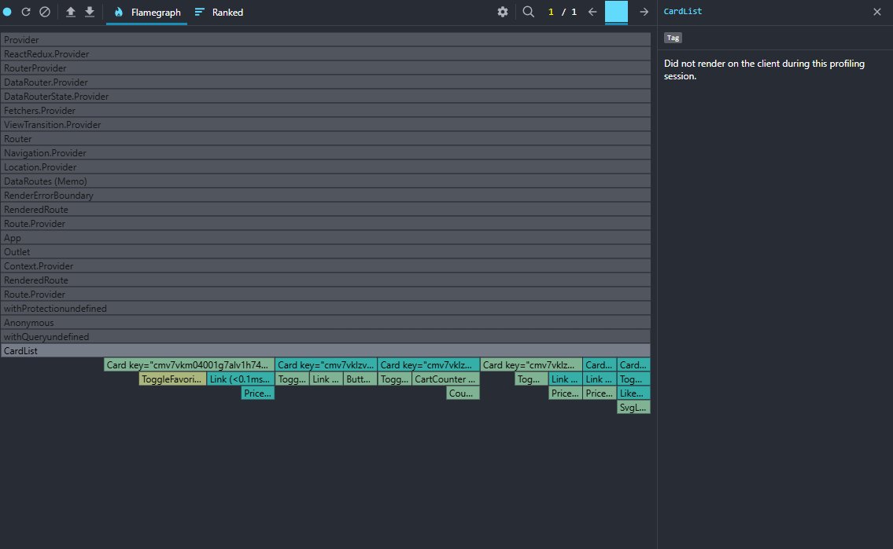
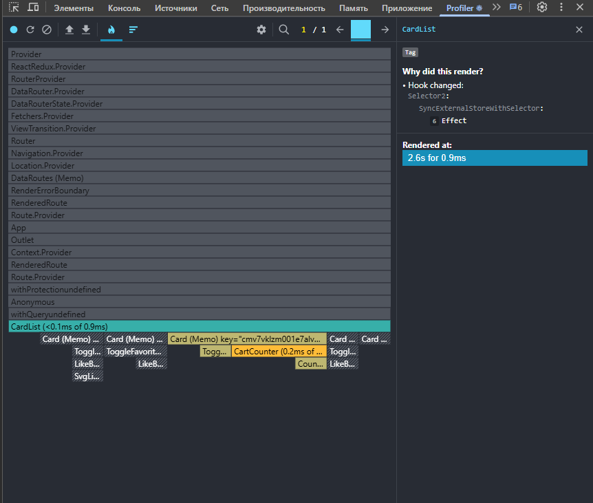
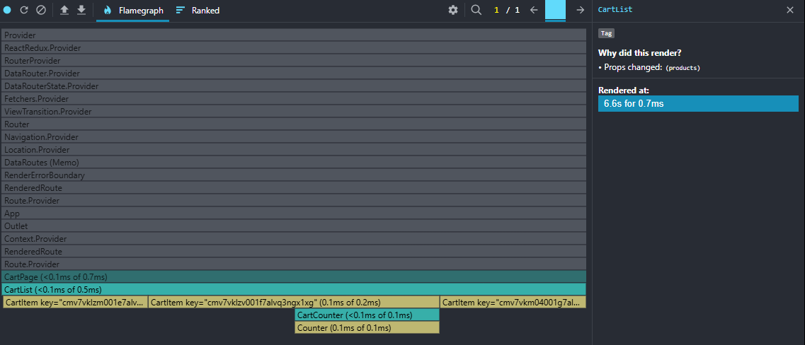
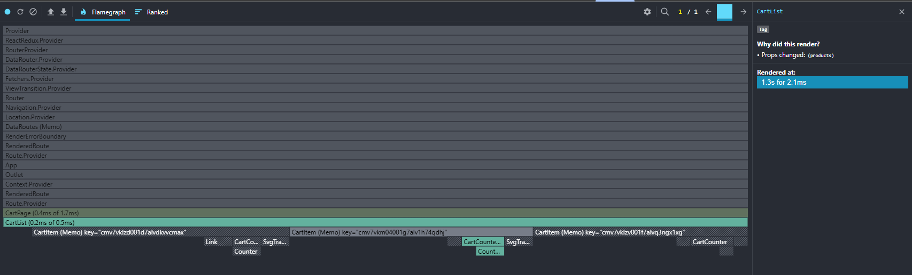
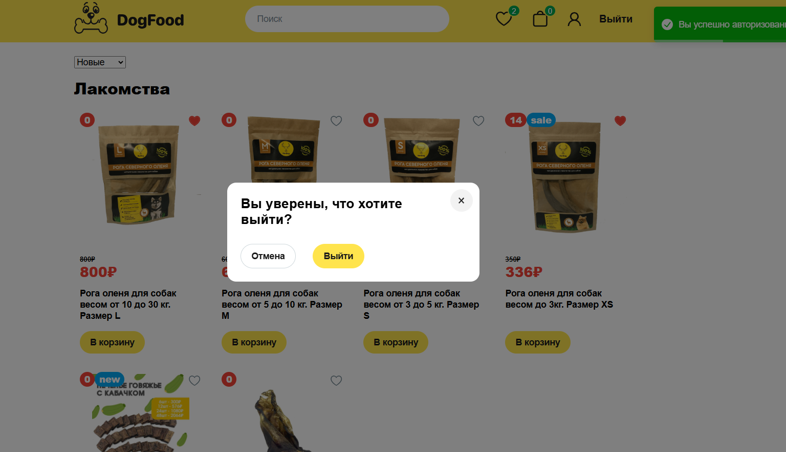
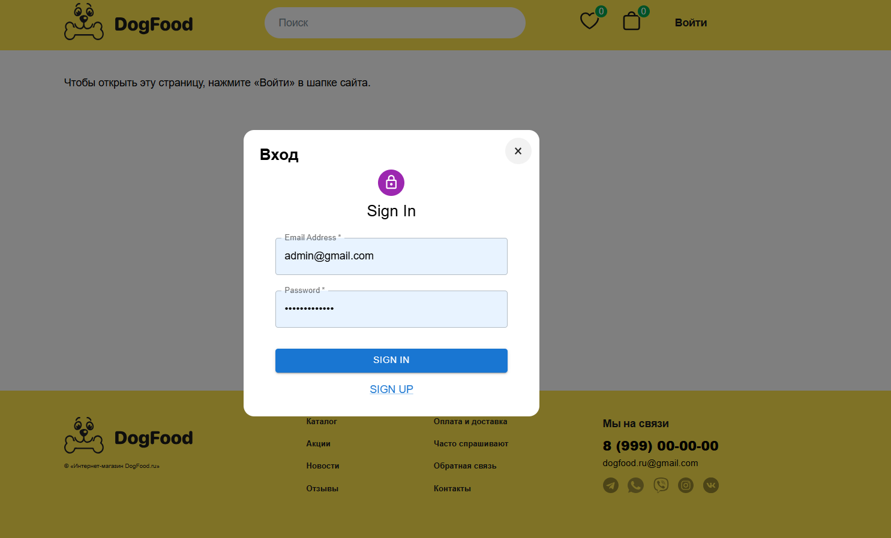
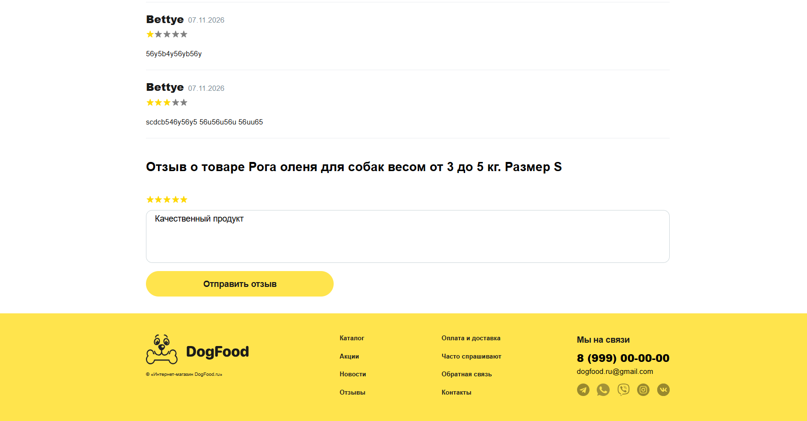
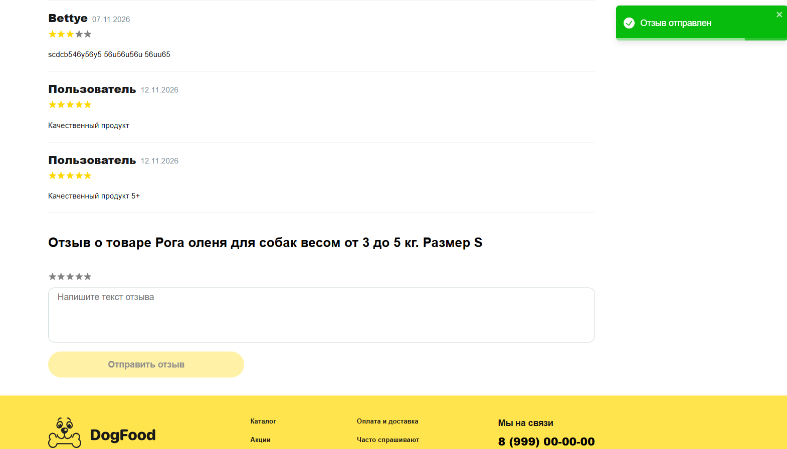

# React PRO — финальный проект

Ветка `final` · [Репозиторий на GitHub](https://github.com/MaryFBakeer/react-pro)

## Запуск

Установить зависимости и запустить приложение из папки `final`.

```bash
npm ci
npm start
```

Dev-сервер открывается на `http://localhost:8080/`. Каталог доступен после входа через кнопку «Войти» в шапке.

Для production-сборки выполнить в отдельном терминале из той же папки одну из команд.

```bash
npm run build
npm run build:esbuild
```

## Что сделано

### Чеклист

#### 1. Архитектура и структура

- [x] В `shared/ui` находятся только презентационные UI-компоненты
      (`Button`, `Input`, `Spinner`, `Select` и `Modal`)
- [x] UI-компоненты не содержат бизнес-логику.
- [x] UI-компоненты не работают напрямую с API.
- [x] UI-компоненты не обращаются напрямую к Redux Store.
- [x] Данные и обработчики передаются в UI-компоненты через `props`.
- [x] Фичи изолированы в отдельных папках.
- [x] Нет необоснованных глубоких цепочек передачи props
      (счётчик корзины выбирает данные своего товара из Redux, а карточка получает признак наличия в корзине напрямую от списка)

#### 2. Оптимизация рендеров

- [x] Использован React DevTools Profiler.
  - **Добавление товара из каталога.** До оптимизации повторно отрендерились 6 видимых карточек `Card`. После оптимизации отрендерилась только карточка добавленного товара. [До](docs/screenshots/catalog-before.png) · [После](docs/screenshots/catalog-after.png)
  - **Изменение количества в корзине.** До оптимизации повторно отрендерились все три строки `CartItem`. После оптимизации `CartList` обновился, все три строки пропустили рендер, а из счётчиков обновился только `CartCounter` выбранного товара. [До](docs/screenshots/cart-before.png) · [После](docs/screenshots/cart-after.png)
- [x] Найден хотя бы один hotspot
      (при изменении корзины рендерились соседние карточки и строки с прежними данными)
- [x] `React.memo` используется там, где это действительно уменьшает количество рендеров
      (`Card` и `CartItem` обёрнуты в `React.memo`. Строка корзины получает отдельные поля товара, значения которых сохраняются при изменении количества)
- [x] `useMemo` применяется для вычислений, которые нет смысла выполнять при каждом рендере
      (`useMemo` сохраняет вычисленный `Set` идентификаторов, пока массив корзины не изменился)
- [x] `useCallback` используется для стабилизации функций там, где это необходимо
      (`useCallback` сохраняет ссылку на обработчик для `IntersectionObserver`, пока его зависимости прежние)
- [x] В README описано, что именно было оптимизировано.

#### 3. React Portal

- [x] Используется `ReactDOM.createPortal`.
- [x] Модальное окно рендерится внутри `#modal-root`.
- [x] Работает закрытие по `Escape`.
- [x] Корректно обработан клик по overlay.
- [x] При первом открытии фокус переходит на кнопку закрытия (крестик).
- [x] При переключении между входом и регистрацией фокус переходит в поле email новой формы.
- [x] После закрытия фокус возвращается на элемент-триггер, если он остаётся на странице.
- [x] После успешной авторизации фокус переходит на ссылку профиля в шапке.
- [x] Модалка используется для входа и регистрации, подтверждения выхода и оформления заказа.

#### 4. Практическое применение useRef

- [x] Есть пример хранения значения через `useRef` без перерендера
      (в формах входа и регистрации ref хранит флаг активного запроса)
- [x] Есть пример взаимодействия с DOM через `ref`
      (при переключении между входом и регистрацией фокус переходит на поле email)
- [x] Использование `useRef` имеет практический смысл.
      (флаг блокирует повторную отправку до завершения текущего запроса)
- [x] При повторном нажатии `SIGN IN` во время активного запроса под кнопкой появляется подсказка «Запрос на вход уже отправлен. Дождитесь ответа». Второй запрос не отправляется. После завершения запроса блок `finally` сбрасывает флаг и скрывает подсказку.

#### 5. Сборка через esbuild

- [x] Альтернативная сборка запускается через `esbuild.config.js`.
- [x] Production build создаётся без ошибок.
- [x] Замерено время сборки Webpack.
- [x] Замерено время альтернативной сборки.
- [x] Сравнён размер итоговых файлов.
- [x] Результаты добавлены в README.

#### 6. React 19 Hooks

- [x] Использован `useActionState` для отправки и хранения результата.
- [x] Реализация находится в реальной части приложения — форме отзыва на странице товара.
- [x] Пользователь видит изменение состояния интерфейса.
      (После успешного добавления появляется отзыв, а текст и оценка сбрасываются. При ошибке форма показывает сообщение и сохраняет введённые значения)
- Для задания выбран `useActionState`, чтобы хранить результат отправки формы и показывать ошибку рядом с полями.

## Структура проекта

```text
final/
├── public/       # HTML-шаблон с root и modal-root
├── docs/         # скриншоты демонстрации и профилирования
├── src/
│   ├── app/      # общий layout, роутер и глобальные стили
│   ├── pages/    # страницы каталога, товара, корзины и профиля
│   ├── widgets/  # шапка, футер, список карточек и отзывы
│   ├── features/ # действия пользователя и логика каталога
│   └── shared/   # UI-компоненты, Redux, API и утилиты
├── webpack/      # конфигурации Webpack
└── esbuild.config.js
```

## Профилирование (React DevTools Profiler)

### 1. Добавление товара из каталога

До оптимизации отрендерились **6 видимых `Card`**. Каждая карточка подписывалась на массив корзины. После оптимизации отрендерилась **1 карточка** добавленного товара. `CardList` передаёт остальным карточкам прежнее значение признака наличия в корзине.

| До                                                                       | После                                                                      |
| ------------------------------------------------------------------------ | -------------------------------------------------------------------------- |
|  |  |

### 2. Изменение количества в корзине

До оптимизации при нажатии «+» отрендерились **3 из 3 `CartItem`**. После оптимизации `CartList` обновился из-за изменения `products`, а все три строки пропустили повторный рендер: значения их props остались прежними. `CartCounter` подписан на `count` и `stock` своего товара, поэтому из трёх счётчиков обновился только тот, у которого изменилось количество.

| До                                                                       | После                                                                      |
| ------------------------------------------------------------------------ | -------------------------------------------------------------------------- |
|  |  |

## Сравнение сборок

| Сборщик | Команда                 | Время, с | Размер, байт | Каталог         |
| ------- | ----------------------- | -------: | -----------: | --------------- |
| Webpack | `npm run build`         |   15,459 |      775 578 | `dist/`         |
| esbuild | `npm run build:esbuild` |    6,289 |    1 254 356 | `esbuild/dist/` |

Время измерено для одного запуска каждой npm-команды на Windows с Node.js 22.14.0. Обе команды включают проверку TypeScript.
Размер посчитан по всем файлам в выходном каталоге до сетевого сжатия. В этом замере esbuild завершил сборку быстрее, а Webpack выдал меньший размер файлов.

Для подробного разбора доступны `npm run build:webpack:verbose`, `npm run build:webpack:stats` и `npm run build:esbuild:analyze`.

## Демонстрация

- **Portal.** После входа нажать «Выйти» в шапке. Откроется окно подтверждения выхода с затемнённым фоном. Его можно закрыть крестиком, клавишей `Esc` или кликом по фону.

  

  Кнопка «Войти» открывает форму входа в портальном окне.

  

- **Форма с `useActionState`.** Войти, открыть страницу товара, поставить оценку и отправить отзыв. Отзыв появляется в списке, поля формы очищаются.

  | До отправки | После отправки |
  |---|---|
  | Введён текст отзыва, выбраны пять звёзд. | Отзыв появился в списке, текст и оценка сброшены. Видно уведомление «Отзыв отправлен». |
  |  |  |

- **Оптимизация рендеров.** Скриншоты до и после приведены в разделе [«Профилирование»](#профилирование-react-devtools-profiler).

## Отличия от задания (осознанные)

- Отзыв хранится локально до ухода со страницы товара. `useActionState` связывает результат отправки с формой, а текст и оценка остаются в `useState`.
- Автофокус поля email срабатывает при переключении форм.

## Обязательные условия зачёта

- [x] Проект запускается и собирается. Проверены Webpack и esbuild.
- [x] Портальная модалка закрывается по `Escape` и клику по фону.
- [x] Хук React 19 применяется в форме отзыва на странице товара.
- [x] В README есть список выполненных работ, структура папок, замеры сборок и демо всех трёх сценариев.

## Итоговый чеклист

- [x] Проект запускается без ошибок.
- [x] Production build успешно создаётся.
- [x] Структура проекта переработана.
- [x] UI-компоненты вынесены в `shared/ui`.
- [x] Фичи разделены по папкам.
- [x] Проведён анализ через React DevTools Profiler.
- [x] Выполнена минимум одна осмысленная оптимизация рендеров.
- [x] Реализован Modal через React Portal.
- [x] Реализовано управление фокусом в модальном окне.
- [x] `useRef` применён для хранения значения без перерендера.
- [x] `useRef` применён для работы с DOM.
- [x] Настроена альтернативная сборка через esbuild.
- [x] Выполнено сравнение сборок.
- [x] Использован `useActionState` или `useOptimistic`.
- [x] README заполнен описанием работ, структурой и сравнением сборок.
- [x] Приложены скриншоты или GIF всех ключевых возможностей.
